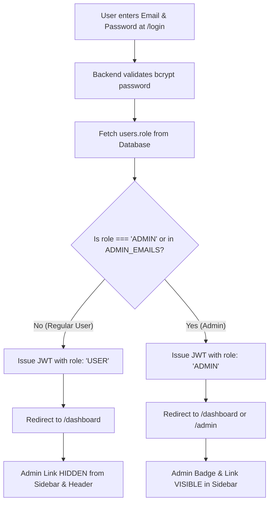

# 👑 WorkPilot / WORKPILOT — Admin Panel Implementation Guide

> **Target Audience**: Harsh & Full-Stack Engineering Team  
> **Objective**: Build an enterprise Admin Control Panel to manage centralized Unipile API credentials, track live connected LinkedIn accounts, calculate estimated monthly Unipile billing, monitor account health, and supervise multi-tenant system operations.
>
> **Core Security Guarantee**: **Strict Role-Based Visibility** — The Admin Panel is **ONLY accessible and visible to authorized Admin accounts (`users.role = 'ADMIN'`)**. Regular users will never see the Admin link, cannot navigate to `/admin`, and cannot call `/api/admin/*` endpoints.

---

## 📌 1. Executive Summary & Why We Need This

Currently, WorkPilot uses a centralized Unipile integration (`UNIPILE_API_KEY` & `UNIPILE_DSN`) stored in `.env`. As users sign up and link their LinkedIn profiles, Unipile creates connected accounts under this master key and bills on a **per-active-account monthly basis**.

### Key Problems the Admin Panel Solves:

1. **Unipile Bill & Account Visibility**: Know at any moment how many LinkedIn accounts are currently active and estimate monthly vendor costs ($5–$8 × active accounts).
2. **Dynamic Credential Management**: Update or rotate Unipile API keys and DSNs via an authenticated UI without SSHing into AWS servers or redeploying containers.
3. **LinkedIn Account Health Supervision**: Identify connected accounts that have fallen into `RECONNECT_REQUIRED`, `CHALLENGED`, or `DISCONNECTED` states.
4. **Cost Control / Force Disconnect**: Disconnect or purge orphaned/dead accounts from Unipile directly from the Admin Panel to prevent unnecessary billing.
5. **System & Queue Telemetry**: Monitor global background queue jobs, failed actions, and circuit breaker events.

---

## 🛡️ 2. Role-Based Access Control (RBAC) & Visibility Rules

### 🚫 How Login Works (NO "Login as Admin" Checkbox)

- **Single Universal Login Page (`/login`)**: Do **NOT** add any "Login as Admin" toggle, checkbox, or separate admin login URL.
- All users (regular users and admins) log in through the exact same `/login` form with their standard email and password.
- **The database decides the role**: The backend validates credentials, queries `users.role`, and embeds `role: 'ADMIN' | 'USER'` inside the signed JWT session.



---

### 🔒 Multi-Layer Security Architecture

| Layer                      | Defense Mechanism                           | Behavior for Regular Users (`USER`)                                      | Behavior for Admins (`ADMIN`)                           |
| :------------------------- | :------------------------------------------ | :----------------------------------------------------------------------- | :------------------------------------------------------ |
| **1. UI Navigation**       | Conditional Sidebar/Header rendering        | "Admin Panel" link/button is **completely hidden**                       | "👑 Admin Center" button is visible in sidebar & header |
| **2. Route Guard**         | `client/app/admin/layout.tsx`               | Entering `/admin` directly triggers instant **redirect to `/dashboard`** | Full access to Admin UI pages                           |
| **3. Backend API Gateway** | `requireAdmin` middleware on `/api/admin/*` | Request blocked with **HTTP 403 Forbidden**                              | Request authorized & processed                          |

---

### 💻 Schema & Code Implementation

#### 1. Database Schema Update (`server/src/db/schema.ts`)

Add `role` to the `users` table:

```typescript
export const users = pgTable("users", {
  id: uuid("id").defaultRandom().primaryKey(),
  name: text("name").notNull(),
  email: varchar("email", { length: 255 }).notNull().unique(),
  password: text("password").notNull(),
  role: text("role").default("USER").notNull(), // 'USER' | 'ADMIN'
  createdAt: timestamp("created_at").defaultNow().notNull(),
  updatedAt: timestamp("updated_at").defaultNow().notNull(),
});
```

#### 2. System Settings Table (`server/src/db/schema.ts`)

Store dynamic system credentials so the admin can change the Unipile key on the fly:

```typescript
export const systemSettings = pgTable("system_settings", {
  key: text("key").primaryKey(), // e.g. 'unipile_api_key', 'unipile_dsn', 'unipile_cost_per_account'
  value: text("value").notNull(),
  description: text("description"),
  updatedAt: timestamp("updated_at").defaultNow().notNull(),
  updatedBy: uuid("updated_by").references(() => users.id, {
    onDelete: "set null",
  }),
});
```

#### 3. Backend Admin Middleware (`server/src/middlewares/admin.middleware.ts`)

```typescript
import { Request, Response, NextFunction } from "express";
import { db } from "../db/client.js";
import { users } from "../db/schema.js";
import { eq } from "drizzle-orm";

export const requireAdmin = async (
  req: Request,
  res: Response,
  next: NextFunction,
) => {
  const userId = req.user?.userId;
  if (!userId) {
    return res
      .status(401)
      .json({
        success: false,
        message: "Authentication required. Please log in.",
      });
  }

  const [user] = await db
    .select({ id: users.id, role: users.role, email: users.email })
    .from(users)
    .where(eq(users.id, userId))
    .limit(1);

  // Super Admin fallback via .env config: ADMIN_EMAILS=sahil@domain.com,harsh@domain.com
  const adminEmails = (process.env.ADMIN_EMAILS || "")
    .split(",")
    .map((e) => e.trim().toLowerCase())
    .filter(Boolean);

  const isSuperAdminEmail =
    user && adminEmails.includes(user.email.toLowerCase());

  if (!user || (user.role !== "ADMIN" && !isSuperAdminEmail)) {
    return res.status(403).json({
      success: false,
      message: "Access forbidden. You do not have administrator privileges.",
    });
  }

  next();
};
```

#### 4. Frontend Route Guard (`client/app/admin/layout.tsx`)

```tsx
"use client";

import { useEffect, useState } from "react";
import { useRouter } from "next/navigation";
import { useAuth } from "@/components/auth/auth-provider"; // or existing auth hook/context
import { ShieldAlert } from "lucide-react";

export default function AdminLayout({
  children,
}: {
  children: React.ReactNode;
}) {
  const { user, isLoading } = useAuth();
  const router = useRouter();

  useEffect(() => {
    if (!isLoading && (!user || user.role !== "ADMIN")) {
      // Non-admin attempted direct URL access — redirect back to user dashboard
      router.replace("/dashboard");
    }
  }, [user, isLoading, router]);

  if (isLoading || !user || user.role !== "ADMIN") {
    return (
      <div className="flex h-screen w-full items-center justify-center bg-slate-950 text-white">
        <div className="flex flex-col items-center gap-3">
          <ShieldAlert className="h-8 w-8 animate-pulse text-amber-500" />
          <p className="text-sm text-slate-400">
            Verifying administrator credentials...
          </p>
        </div>
      </div>
    );
  }

  return (
    <div className="min-h-screen bg-slate-950 text-slate-100 flex">
      {/* Admin Sidebar & Header Navigation */}
      <div className="flex-1 flex flex-col">{children}</div>
    </div>
  );
}
```

#### 5. Frontend Navigation Visibility (`client/components/dashboard/dashboard-sidebar.tsx`)

In the existing sidebar, render the Admin Center entry point **ONLY IF** `user.role === 'ADMIN'`:

```tsx
{
  /* Render Admin entry point exclusively for Admins */
}
{
  user?.role === "ADMIN" && (
    <div className="pt-4 border-t border-slate-800/80">
      <Link
        href="/admin"
        className="flex items-center gap-2.5 px-3 py-2 rounded-lg text-amber-400 bg-amber-500/10 hover:bg-amber-500/20 transition-colors border border-amber-500/20 text-sm font-medium"
      >
        <ShieldCheck className="h-4 w-4" />
        <span>Admin Center</span>
        <span className="ml-auto text-[10px] uppercase font-bold bg-amber-500/20 text-amber-300 px-1.5 py-0.5 rounded">
          Staff
        </span>
      </Link>
    </div>
  );
}
```

---

### 👑 How to Grant First Admin Access (Bootstrap)

#### Option 1: Direct Database Update (Production DB)

Run this SQL command in Neon / PostgreSQL:

```sql
UPDATE users SET role = 'ADMIN' WHERE email = 'sahil@yourdomain.com';
```

#### Option 2: Environment Variable Bootstrap (`server/.env`)

Add admin emails to `server/.env`:

```env
ADMIN_EMAILS=sahil@yourdomain.com,harsh@yourdomain.com
```

Anyone logging in with this email automatically gets full Admin permissions!

---

## 🔌 3. Backend API Specifications for Admin Panel

All admin routes live under `/api/admin/*` and require both `authenticate` and `requireAdmin`.

### Summary of New Admin Endpoints:

| Endpoint                                        | Method | Purpose                                                                          |
| :---------------------------------------------- | :----: | :------------------------------------------------------------------------------- |
| `/api/admin/overview`                           | `GET`  | Dashboard KPIs (Total Users, Active Accounts, Unipile Cost, Health Breakdown)    |
| `/api/admin/linkedin-accounts`                  | `GET`  | List all connected LinkedIn accounts with user metadata, health & billing status |
| `/api/admin/linkedin-accounts/:id/disconnect`   | `POST` | Force disconnect an account & delete from Unipile to stop billing                |
| `/api/admin/linkedin-accounts/:id/check-health` | `POST` | Trigger instant live health check with Unipile API                               |
| `/api/admin/users`                              | `GET`  | List all platform users, their connected accounts count, and signup dates        |
| `/api/admin/settings/unipile`                   | `GET`  | Get current Unipile configuration (API key masked: `uni_****...1234`)            |
| `/api/admin/settings/unipile`                   | `POST` | Update Unipile API Key & DSN dynamically                                         |
| `/api/admin/settings/unipile/test`              | `POST` | Test connection to Unipile with provided or stored credentials                   |
| `/api/admin/queue/stats`                        | `GET`  | Global queue telemetry (pending, running, failed today)                          |

---

### Detailed Endpoint Implementations

#### 1. `GET /api/admin/overview`

Returns high-level platform health, account volume, and estimated billing metrics.

**Response Structure (`200 OK`)**:

```json
{
  "success": true,
  "data": {
    "metrics": {
      "totalUsers": 124,
      "totalConnectedAccounts": 86,
      "totalDisconnectedAccounts": 14,
      "estimatedMonthlyBillUSD": 688.0,
      "costPerAccountUSD": 8.0
    },
    "healthBreakdown": {
      "healthy": 78,
      "reconnectRequired": 5,
      "challenged": 3,
      "disconnected": 14
    },
    "automationBreakdown": {
      "running": 62,
      "paused": 24
    },
    "recentActivity": [
      {
        "userName": "Rahul Sharma",
        "userEmail": "rahul@example.com",
        "linkedinName": "Rahul Sharma",
        "action": "ACCOUNT_CONNECTED",
        "timestamp": "2026-09-06T08:30:00Z"
      }
    ]
  }
}
```

#### 2. `GET /api/admin/linkedin-accounts`

Query params: `?status=ALL|HEALTHY|CHALLENGED|DISCONNECTED&search=&page=1&limit=20`

**Response Structure (`200 OK`)**:

```json
{
  "success": true,
  "data": {
    "accounts": [
      {
        "id": "b3e2b260-...",
        "userId": "a1f94c12-...",
        "userName": "Pooja Verma",
        "userEmail": "pooja@techcorp.io",
        "unipileAccountId": "acc_78x92abc1",
        "linkedinName": "Pooja Verma",
        "linkedinEmail": "pooja.verma@gmail.com",
        "isConnected": true,
        "healthStatus": "HEALTHY",
        "automationStatus": "RUNNING",
        "dailyConnectionsLimit": 25,
        "createdAt": "2026-08-15T10:00:00Z",
        "billableThisMonth": true
      }
    ],
    "pagination": {
      "page": 1,
      "limit": 20,
      "total": 86
    }
  }
}
```

#### 3. `POST /api/admin/linkedin-accounts/:id/disconnect`

Forces disconnect of the LinkedIn account:

1. Calls Unipile API: `DELETE /api/v1/accounts/{unipileAccountId}` (stops vendor billing).
2. Updates database record: `isConnected = false`, `healthStatus = 'DISCONNECTED'`, `automationStatus = 'PAUSED'`.
3. Returns confirmation JSON.

#### 4. `GET /api/admin/settings/unipile`

Fetches current credentials. **Never expose the full raw secret key to frontend!**

**Response Structure (`200 OK`)**:

```json
{
  "success": true,
  "data": {
    "dsn": "https://api6.unipile.com:13474",
    "apiKeyMasked": "uni_live_********************a94f",
    "isConfigured": true,
    "source": "DATABASE", // or "ENV_VARIABLE"
    "estimatedCostPerAccount": 8.0
  }
}
```

#### 5. `POST /api/admin/settings/unipile`

Updates dynamic credentials in the `system_settings` table.

**Request Payload**:

```json
{
  "dsn": "https://api6.unipile.com:13474",
  "apiKey": "new_unipile_api_key_here",
  "estimatedCostPerAccount": 7.5
}
```

#### 6. `POST /api/admin/settings/unipile/test`

Validates credentials against live Unipile servers (`GET /api/v1/accounts` with `limit=1`).

**Response Structure (`200 OK`)**:

```json
{
  "success": true,
  "message": "Connection to Unipile established successfully.",
  "unipileStatus": 200,
  "remoteAccountCount": 86
}
```

---

## 🎨 4. Frontend Implementation Blueprint (Next.js)

Harsh should implement the Admin UI inside `client/app/admin/*` using the existing design system tokens, Tailwind CSS, Lucide icons, and modern glassmorphic cards.

### Route Structure:

```text
client/
  app/
    admin/
      layout.tsx           # Route protection guard + Admin navigation
      page.tsx             # Overview KPI dashboard & quick actions
      accounts/
        page.tsx           # LinkedIn accounts list with health filters & disconnect modal
      users/
        page.tsx           # Platform users list & registration stats
      settings/
        page.tsx           # Dynamic Unipile credentials & cost config
      queue/
        page.tsx           # Global queue monitor & circuit breaker logs
```

---

### 🖥️ Admin UI Component Breakdown

#### A. Overview Dashboard (`/admin`)

```text
+----------------------------------------------------------------------------------+
|  👑 WorkPilot Admin Center                                       [Sahil Admin ▼] |
+----------------------------------------------------------------------------------+
|  [ 👥 Total Users ]   [ 🔗 Connected Accounts ]   [ 💵 Est. Unipile Bill ]       |
|        124                   86 Active                   $688.00 / mo            |
|    +12 this week          14 Disconnected              ($8.00 / account)         |
+----------------------------------------------------------------------------------+
|  Account Health Status                     |  Unipile Master Key Status          |
|  🟢 Healthy: 78 accounts                   |  DSN: api6.unipile.com:13474        |
|  🟡 Reconnect Required: 5 accounts         |  Key: uni_live_************a94f     |
|  🔴 Challenged: 3 accounts                 |  Status: 🟢 Connected (Checked 2m) |
|  ⚪ Disconnected: 14 accounts              |  [ ⚙️ Update Credentials ]          |
+----------------------------------------------------------------------------------+
|  Recent Account Connections & Health Alerts                                      |
|  - Pooja Verma (pooja@techcorp.io) connected LinkedIn [acc_78x92]     10m ago   |
|  - Amit Shah account entered CHALLENGED state (Circuit tripped)        1h ago    |
+----------------------------------------------------------------------------------+
```

#### B. LinkedIn Accounts Monitor (`/admin/accounts`)

Features required:

- **Filter pills**: `All (100)`, `Healthy (78)`, `Needs Action (8)`, `Disconnected (14)`.
- **Search input**: Search by user email, user name, or LinkedIn profile name.
- **Table Columns**:
  1. User (Name & Email)
  2. LinkedIn Name / Profile
  3. Unipile Account ID
  4. Health Status (Badge: `HEALTHY` in green, `CHALLENGED` in amber, `DISCONNECTED` in gray)
  5. Automation Status (`RUNNING` / `PAUSED`)
  6. Connected Date
  7. Actions:
     - `🔄 Re-Check Health` (Calls `/api/admin/linkedin-accounts/:id/check-health`)
     - `🛑 Force Disconnect` (Modal: "This will delete the account from Unipile to stop recurring billing. Continue?")

#### C. Unipile Settings & Credential Manager (`/admin/settings`)

Features required:

- **DSN Field**: `https://api6.unipile.com:13474`
- **API Key Field**: Input with hide/reveal toggle and placeholder showing current masked key.
- **Cost Per Account ($ USD)**: Input field (e.g. `8.00`) to customize bill calculation.
- **Actions**:
  - `🧪 Test Connection`: Makes a dry-run ping to verify key without saving.
  - `💾 Save & Apply`: Writes to database; takes effect immediately across all backend requests.

---

## 🔒 5. Security & Isolation Safeguards

1. **Masked Secrets**: Never send raw unmasked `UNIPILE_API_KEY` to the client in `GET` responses. Only send `uni_live_****` + last 4 characters.
2. **Audit Trail**: Whenever credentials are changed or an account is force-disconnected by an admin, log an audit entry in the server console/database with `timestamp`, `adminUserId`, and `actionType`.
3. **Graceful Fallback**: If `system_settings` table is empty or unpopulated, the backend must smoothly fall back to `process.env.UNIPILE_API_KEY` and `process.env.UNIPILE_DSN`.
4. **Rate Limiting**: Protect admin testing endpoints (`/settings/unipile/test`) with rate-limiting to avoid spamming the Unipile API.

---

## 🚀 6. Step-by-Step Task Checklist for Harsh

- [ ] **Step 1 (DB Schema)**: Add `role: text("role").default("USER").notNull()` to `users` table and create `system_settings` table in `server/src/db/schema.ts`. Run `npm run db:push` or migration.
- [ ] **Step 2 (Admin Middleware)**: Create `server/src/middlewares/admin.middleware.ts` with `requireAdmin` logic and `.env` `ADMIN_EMAILS` fallback.
- [ ] **Step 3 (Admin Routes & Controller)**: Create `server/src/routes/admin.routes.ts` and `server/src/controllers/admin.controller.ts` with the 8 endpoints listed in Section 3.
- [ ] **Step 4 (Unipile Client Dynamic Resolver)**: Update `server/src/services/unipile/unipile.client.ts` to read keys from `systemSettings` table first, falling back to `.env`.
- [ ] **Step 5 (Frontend Layout & Nav)**:
  - Create `client/app/admin/layout.tsx` with role guard (`user.role !== 'ADMIN'` redirects to `/dashboard`).
  - In `dashboard-sidebar.tsx`, wrap the Admin link inside `{user?.role === 'ADMIN' && (...) }` so normal users never see it.
- [ ] **Step 6 (Frontend UI Pages)**: Build `/admin` (Overview), `/admin/accounts` (Accounts table), and `/admin/settings` (Unipile key manager).
- [ ] **Step 7 (Test & Verify)**: Run `npm run build` on both client and server to verify zero TypeScript errors.

---

_Authored for WorkPilot / WORKPILOT Development Team._
