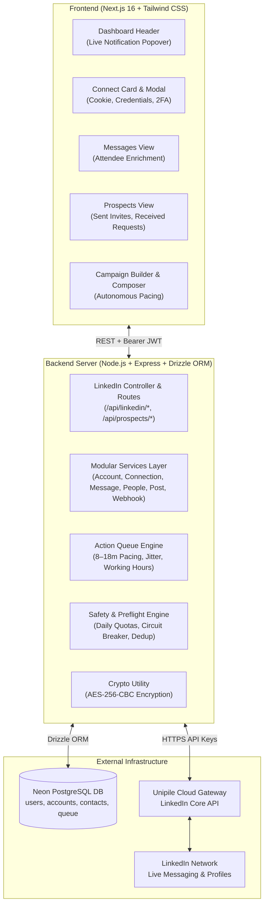
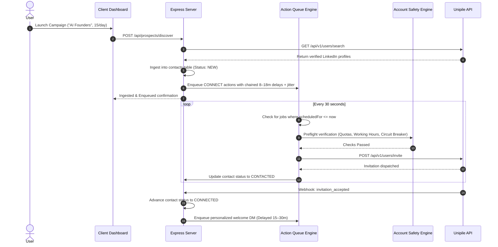
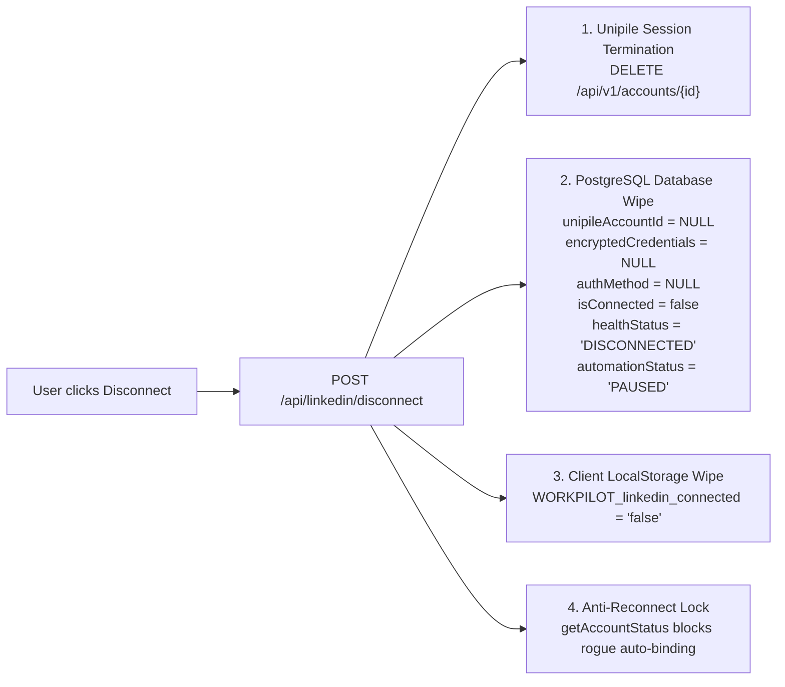

# WORKPILOT — LinkedIn Integration & Automation Architecture

### Complete Technical Reference: From Account Connection to Disconnect Wipe

---

## 1. Executive Summary & Architecture Overview

WORKPILOT provides an enterprise-grade LinkedIn outreach and relationship management automation suite built on top of the **Unipile Unified API** and **Neon PostgreSQL**.

Rather than relying on brittle browser scraping or risky unofficial browser extensions, WORKPILOT interacts through a secure API gateway with residential proxy routing, human-like pacing, and rigorous preflight safety checks.



---

## 2. Account Connection & Authentication

### 2.1 Supported Authentication Methods

WORKPILOT supports three distinct connection mechanisms via [account.service.ts](file:///d:/WORKPILOT%20Connect/server/src/services/linkedin/account.service.ts) and [linkedin-connect-modal.tsx](file:///d:/WORKPILOT%20Connect/client/components/dashboard/linkedin-connect-modal.tsx):

1. **Session Cookie Authentication (`li_at` + `li_a`)**:
   - Safest and fastest connection path.
   - User inputs their active `li_at` session cookie.
   - Bypasses initial login challenges and immediately initializes the Unipile session.
2. **Native Credentials (Email & Password)**:
   - User provides LinkedIn username/password and country.
   - Dispatches `POST /api/v1/accounts` with `provider: "LINKEDIN"`.
3. **Hosted Onboarding Link**:
   - Generates a hosted Unipile authentication URL (`GET /api/linkedin/connect`) for guided browser login.

### 2.2 Dynamic Checkpoint & 2FA Resolution Engine

When logging in with credentials, LinkedIn frequently issues security checkpoints. WORKPILOT provides a full multi-stage checkpoint resolver:

- **Challenge Detection**: Identifies whether the checkpoint requires `2FA` (Authenticator App), `OTP` (SMS/Email code), or `IN_APP_VALIDATION` (Mobile LinkedIn App prompt).
- **Code Submission**: `POST /api/linkedin/checkpoint/solve` submits the verification code directly to Unipile's `/api/v1/accounts/checkpoint`.
- **Code Resend**: `POST /api/linkedin/checkpoint/resend` requests a fresh SMS/Email code.
- **Async Status Polling**: `GET /api/linkedin/checkpoint/status/:accountId` polls the account state until it switches from `CHALLENGED` to `OK`.

### 2.3 Credential Security & AES-256-CBC Encryption

To allow silent session recovery without storing plaintext user passwords:

- [crypto.util.ts](file:///d:/WORKPILOT%20Connect/server/src/utils/crypto.util.ts) implements military-grade AES-256-CBC encryption:
  ```typescript
  export function encryptData(plainText: string): string;
  export function decryptData(cipherText: string): string;
  ```
- Uses a 32-byte encryption key derived from `ENCRYPTION_SECRET` or `JWT_SECRET` with a randomized 16-byte initialization vector (IV) prepended to the ciphertext.
- Stored in the database `linkedin_accounts` table:
  - `encryptedCredentials`: Encrypted payload containing either `{ li_at, li_a }` or `{ username, password, country }`.
  - `authMethod`: `"COOKIE"` or `"CREDENTIALS"`.

### 2.4 Session Persistence & Anti-Disconnect Fix

**The Problem Solved**: Previously, reloading the page reset the LinkedIn connection to disconnected.
**Root Causes Fixed**:

1. **Unipile Health Schema**: Unipile returns status under `sources[0].status = "OK"`, not `account.status`. Checking `account.status === "OK"` returned `undefined`, falsely marking the account disconnected. We built `UnipileClient.extractStatus()` to inspect root status, `sources[0].status`, and `connection_status`.
2. **Synthetic Overwrites**: Prevented `syncAccount()` from overwriting real Unipile account IDs with temporary mock strings.
3. **Silent Auto-Recovery**: If a session temporarily disconnects, `account.service.ts` decrypts the credentials and re-authenticates silently in the background without disturbing the user.

---

## 3. Modular LinkedIn Services Layer

All LinkedIn logic is structured into dedicated, single-responsibility services located in `server/src/services/linkedin/`:

| Service File                                                                                               | Primary Responsibilities                                                                                 | Key Methods                                                                                                                        |
| :--------------------------------------------------------------------------------------------------------- | :------------------------------------------------------------------------------------------------------- | :--------------------------------------------------------------------------------------------------------------------------------- |
| [account.service.ts](file:///d:/WORKPILOT%20Connect/server/src/services/linkedin/account.service.ts)       | Session lifecycle, auth, checkpoints, health status sync, and disconnect cleanup.                        | `connectWithCredentials`, `connectWithCookie`, `solveCheckpoint`, `getAccountStatus`, `disconnect`                                 |
| [connection.service.ts](file:///d:/WORKPILOT%20Connect/server/src/services/linkedin/connection.service.ts) | Connection requests, sent invites tracking, invitation withdrawal, incoming request management.          | `sendConnectionRequest`, `getSentRequests`, `cancelSentRequest`, `getReceivedInvitations`, `acceptInvitation`, `declineInvitation` |
| [message.service.ts](file:///d:/WORKPILOT%20Connect/server/src/services/linkedin/message.service.ts)       | Inbox synchronization, attendee profile picture/name enrichment, DM dispatch, rich messages.             | `getConversations`, `getMessages`, `sendMessage`, `sendRichMessage`, `markConversationRead`                                        |
| [people.service.ts](file:///d:/WORKPILOT%20Connect/server/src/services/linkedin/people.service.ts)         | Profile search, full contact extraction, company search, company detail retrieval.                       | `searchPeople`, `getProfile`, `searchCompanies`, `getCompanyProfile`                                                               |
| [post.service.ts](file:///d:/WORKPILOT%20Connect/server/src/services/linkedin/post.service.ts)             | Feed interactions, post creation with media, post deletion, comment submission, reaction dispatch.       | `createPost`, `deletePost`, `getFeed`, `commentOnPost`, `reactToPost`                                                              |
| [recruiting.service.ts](file:///d:/WORKPILOT%20Connect/server/src/services/linkedin/recruiting.service.ts) | Job posting directory search and full job specification retrieval.                                       | `searchJobs`, `getJobDetails`                                                                                                      |
| [webhook.service.ts](file:///d:/WORKPILOT%20Connect/server/src/services/linkedin/webhook.service.ts)       | Real-time Unipile event ingestion (`message_received`, `invitation_accepted`, `account_status_changed`). | `handleWebhookEvent`, `listWebhooks`, `registerWebhook`                                                                            |

---

## 4. Real Data Features & Mock Purge

### 4.1 Complete Mock Data Purge

All legacy placeholder contacts (`Amit Verma`, `Priya Patel`, `Rahul Sharma`, `Dubai Metro Realty`) were completely purged:

- Deleted from Neon PostgreSQL `contacts` and `action_queue` tables.
- Sanitized in [storage.ts](file:///d:/WORKPILOT%20Connect/client/lib/storage.ts) via `purgeLegacyMockData()` to prevent mock persistence in `localStorage`.
- Sanitized in [use-dashboard.ts](file:///d:/WORKPILOT%20Connect/client/lib/use-dashboard.ts) to filter out mock names automatically.

### 4.2 Live Messaging with Attendee Enrichment

- **Attendee Resolution**: [message.service.ts](file:///d:/WORKPILOT%20Connect/server/src/services/linkedin/message.service.ts) fetches `/api/v1/chats` and concurrently queries `/api/v1/chat_attendees`. It matches `attendee_provider_id` to attach real attendee names, profile pictures, headlines, and LinkedIn URLs to every chat thread.
- **Frontend Chat**: [messages-view.tsx](file:///d:/WORKPILOT%20Connect/client/components/dashboard/views/messages-view.tsx) renders genuine profile pictures, real-time message bubbles, relative timestamps, and provides a direct input to send real DMs through Unipile.

### 4.3 Live Sent & Incoming Invitations Management

- **Sent Invitations**: Queries `/api/v1/users/invite/sent` to display live pending outbound connection requests. Users can click **Withdraw** to cancel a sent request via `DELETE /api/v1/users/invite/sent/{id}`.
- **Incoming Invitations**: Queries `/api/v1/users/relations?status=PENDING` to render real incoming connection requests with recipient profile pictures, headlines, and one-click **Accept** and **Decline** actions.
- **Live Search Modal**: [linkedin-prospect-search-modal.tsx](file:///d:/WORKPILOT%20Connect/client/components/dashboard/linkedin-prospect-search-modal.tsx) allows typing any job title or industry, querying LinkedIn directly, and sending invites with personalized notes.

---

## 5. Autonomous Campaigns with Human Pacing

### 5.1 The 5-Stage Campaign Lifecycle



### 5.2 Anti-Burst Chained Delays & Jitter Algorithm

In [queue.service.ts](file:///d:/WORKPILOT%20Connect/server/src/services/queue/queue.service.ts):

- Outbound jobs are chained after previously scheduled jobs to guarantee spacing:
  $$\text{Scheduled Time} = \text{Latest Job Time} + \text{Base Delay (8–14m)} + \text{Jitter (0–5m)}$$
- Jitter ensures intervals vary unpredictably (e.g. 11m, 16m, 9m, 13m) to match organic human behavior.

### 5.3 Working Hours Boundaries & Overnight Rollover

Outreach is restricted to active business hours (**8:30 AM to 7:30 PM**):

- If an action's scheduled time exceeds 7:30 PM, it automatically rolls forward to **9:00 AM the following morning** plus 5–25 minutes of randomized jitter.
- Eliminates late-night activity that flags accounts for automated bot usage.

### 5.4 8-Point Preflight Safety Engine

Implemented in [safety.service.ts](file:///d:/WORKPILOT%20Connect/server/src/services/safety/safety.service.ts):

1. **Account Connectivity**: Verifies `isConnected === true`.
2. **Account Health**: Confirms health status is `HEALTHY` (not degraded or challenged).
3. **Automation Status**: Verifies user has not paused automation.
4. **Daily Connection Quota**: Enforces strict ceiling (default: 25 invites/day).
5. **Daily Message Quota**: Enforces strict ceiling (default: 50 DMs/day).
6. **Recipient Deduplication**: Confirms an invite was never previously sent to this person.
7. **Message Content Deduplication**: Ensures identical copy is not spammed to the same contact.
8. **Circuit Breaker**: Immediately pauses the queue upon detecting any rate limit or warning from Unipile.

---

## 6. Live Dashboard Notifications Center

Implemented in [notifications-popover.tsx](file:///d:/WORKPILOT%20Connect/client/components/dashboard/notifications-popover.tsx) and embedded in [dashboard-header.tsx](file:///d:/WORKPILOT%20Connect/client/components/dashboard/dashboard-header.tsx):

- **Header Trigger**: Bell icon with a dynamic badge displaying total unread items (e.g., `9+` new items).
- **Tabbed Layout**:
  - **All**: Consolidated feed of connection requests, messages, and safety alerts.
  - **Invitations**: Live incoming LinkedIn connection requests with sender avatars, headlines, and inline **Accept** and **Decline** action buttons.
  - **Messages**: Recent conversations with unread indicators and click-to-navigate thread links.
  - **Health & Quota**: Live LinkedIn account status (`HEALTHY`), remaining daily connection budget (`25 / 25 remaining`), and queue status.
- **Interactive Controls**: Instant refresh button, mark-all-read clearing, and outside-click dismissal.

---

## 7. Account Disconnection & Credential Cleanup

When a user disconnects their account, WORKPILOT performs an exhaustive cleanup from client to external cloud gateway:



1. **Remote Gateway Termination**: `unipileClient.disconnectAccount(accountId)` terminates the active session on Unipile.
2. **PostgreSQL Credential Wipe**: Clears `unipileAccountId`, `encryptedCredentials`, and `authMethod` to `NULL`. Sets `isConnected = false` and `healthStatus = "DISCONNECTED"`.
3. **Frontend State Purge**: Clears `localStorage` and resets dashboard health cards.
4. **Anti-Reconnect Protection**: `getAccountStatus()` verifies if the account is in `DISCONNECTED` state or has no account ID, immediately returning disconnected without attempting background discovery or re-binding.

---

## 8. Complete API Endpoints Reference

### Authentication & Account Management

| Method | Route                                 | Description                               | Auth Required |
| :----- | :------------------------------------ | :---------------------------------------- | :------------ |
| `GET`  | `/api/linkedin/connect`               | Generates hosted Unipile onboarding URL   | Yes           |
| `POST` | `/api/linkedin/connect/credentials`   | Native login with email and password      | Yes           |
| `POST` | `/api/linkedin/connect/cookie`        | Session cookie login with `li_at`         | Yes           |
| `POST` | `/api/linkedin/checkpoint/solve`      | Solves 2FA / OTP verification checkpoint  | Yes           |
| `POST` | `/api/linkedin/checkpoint/resend`     | Resends verification SMS/Email code       | Yes           |
| `GET`  | `/api/linkedin/checkpoint/status/:id` | Polls checkpoint verification status      | Yes           |
| `GET`  | `/api/linkedin/status`                | Returns account connectivity and health   | Yes           |
| `GET`  | `/api/linkedin/account`               | Retrieves connected LinkedIn profile info | Yes           |
| `POST` | `/api/linkedin/disconnect`            | Wipes credentials and terminates session  | Yes           |

### Connections & Invitations

| Method   | Route                                   | Description                                | Auth Required |
| :------- | :-------------------------------------- | :----------------------------------------- | :------------ |
| `POST`   | `/api/linkedin/connection`              | Dispatches outbound connection invite      | Yes           |
| `GET`    | `/api/linkedin/invitations/sent`        | Retrieves pending sent connection requests | Yes           |
| `DELETE` | `/api/linkedin/invitations/sent/:id`    | Withdraws / cancels a sent invitation      | Yes           |
| `GET`    | `/api/linkedin/invitations/received`    | Retrieves incoming connection requests     | Yes           |
| `POST`   | `/api/linkedin/invitations/:id/accept`  | Accepts an incoming connection request     | Yes           |
| `POST`   | `/api/linkedin/invitations/:id/decline` | Declines an incoming connection request    | Yes           |

### Messaging & Inbox

| Method  | Route                                      | Description                                   | Auth Required |
| :------ | :----------------------------------------- | :-------------------------------------------- | :------------ |
| `GET`   | `/api/linkedin/conversations`              | Lists chat threads with enriched attendees    | Yes           |
| `GET`   | `/api/linkedin/conversations/:id/messages` | Retrieves messages for a specific chat        | Yes           |
| `POST`  | `/api/linkedin/message`                    | Sends a direct message via Unipile            | Yes           |
| `POST`  | `/api/linkedin/messages/rich`              | Sends rich messages (voice note, attachments) | Yes           |
| `PATCH` | `/api/linkedin/conversations/:id/read`     | Marks conversation as read or unread          | Yes           |

### Prospecting & Autonomous Queue

| Method | Route                               | Description                                     | Auth Required |
| :----- | :---------------------------------- | :---------------------------------------------- | :------------ |
| `GET`  | `/api/linkedin/search`              | Searches LinkedIn people directory              | Yes           |
| `GET`  | `/api/linkedin/profile/:identifier` | Extracts full LinkedIn profile details          | Yes           |
| `POST` | `/api/prospects/discover`           | Discovers leads & queues paced invites          | Yes           |
| `POST` | `/api/prospects/connect`            | Enqueues a single paced connection invite       | Yes           |
| `GET`  | `/api/stats`                        | Returns queue statistics (queued, done, paused) | Yes           |
| `POST` | `/api/process`                      | Processes due actions immediately               | Yes           |
| `POST` | `/api/pause`                        | Manually pauses outbound automation             | Yes           |
| `POST` | `/api/resume`                       | Resumes paused outbound automation              | Yes           |

### Webhooks, Feed & Recruiting

| Method   | Route                            | Description                              | Auth Required            |
| :------- | :------------------------------- | :--------------------------------------- | :----------------------- |
| `POST`   | `/api/linkedin/webhook`          | Ingests real-time Unipile webhook events | Public (Secret Verified) |
| `POST`   | `/api/linkedin/posts`            | Publishes a LinkedIn post with media     | Yes                      |
| `DELETE` | `/api/linkedin/posts/:postId`    | Deletes a published LinkedIn post        | Yes                      |
| `POST`   | `/api/linkedin/react`            | Submits reaction (LIKE, CELEBRATE, etc.) | Yes                      |
| `POST`   | `/api/linkedin/comment`          | Adds a comment to a LinkedIn post        | Yes                      |
| `GET`    | `/api/linkedin/companies/search` | Searches companies on LinkedIn           | Yes                      |
| `GET`    | `/api/linkedin/companies/:id`    | Retrieves company profile & details      | Yes                      |
| `GET`    | `/api/linkedin/jobs/search`      | Searches job postings on LinkedIn        | Yes                      |
| `GET`    | `/api/linkedin/jobs/:id`         | Retrieves full job posting details       | Yes                      |

---

## 9. Verification & Testing Instructions

1. **Verify Backend Compilation**:
   ```bash
   cd "d:\WORKPILOT\server"
   npx tsc --noEmit
   ```
2. **Verify Frontend Compilation**:
   ```bash
   cd "d:\WORKPILOT\client"
   npx tsc --noEmit
   ```
3. **Manual Browser Validation Checklist**:
   - [x] Connect LinkedIn via `li_at` cookie or username/password with checkpoint solver.
   - [x] Refresh browser: verify LinkedIn account remains connected (`Harsh Pandey · HEALTHY`).
   - [x] Click top header notification bell: confirm popover displays live incoming requests with Accept/Decline.
   - [x] Go to **Messages**: verify real chat attendee names, avatars, and conversation bubbles.
   - [x] Go to **Prospects & Pipeline**: verify sent invitations with Withdraw and incoming requests.
   - [x] Launch a Campaign: verify prospects are ingested and queued with human delays (8–18m apart).
   - [x] Click **Disconnect**: verify credentials and session are completely purged from database and UI.
