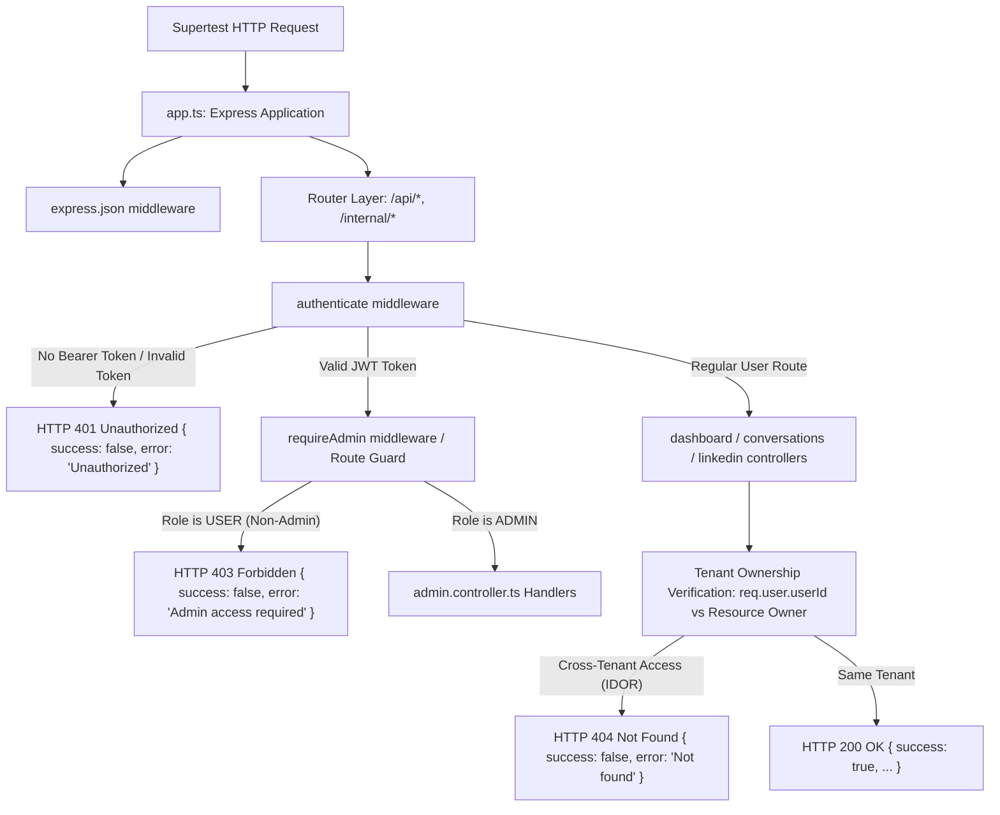

# WP-03 HTTP Integration Test Evidence & Routing Boundary Verification

**Target Commit Baseline:** `d4605327b523a11d362afc45620dd759c601a5bf`  
*Notice: This Git hash identifies the upstream commit where the readiness audit began. Uncommitted working-tree changes and audit evidence are preserved locally and have not been committed.*  
**Document ID:** `WP-03-HTTP-INT-01`  
**Date:** 2026-10-24T17:42:00+05:30  
**Current WP-03 Status:** **`PARTIALLY COMPLETE`** (HTTP routing & middleware integration verified; database row-level isolation and cloud credential rotation remain pending)  
**WP-02 Status:** **`BLOCKED`**  
**Cloud Credential Rotation:** **`PENDING AUTHORIZED OPERATOR ACTION`**  

---

## 1. Executive Summary & Objective

In the previous independent acceptance audit ([`independent-acceptance-audit.md`](file:///c:/Users/Admin/OneDrive/Desktop/unipile/audit-evidence/WP-03/d4605327b523a11d362afc45620dd759c601a5bf/independent-acceptance-audit.md)), Finding #11 highlighted that while the 14 tenant-isolation tests exercised controller functions directly (`controller(req, res)`), they did not exercise the **Express application routing pipeline, router mounts, middleware chaining (`authenticate`, `requireAdmin`), or URL route parameter parsing**.

To resolve Finding #11 without introducing external network calls or database dependencies:
1. **Supertest** (`supertest@7.3.1`, `@types/supertest@7.2.1`) was safely introduced as a narrowly scoped devDependency in `server/devDependencies`.
2. A dedicated HTTP integration test suite ([`server/src/__tests__/integration/http-routes.test.ts`](file:///c:/Users/Admin/OneDrive/Desktop/unipile/server/src/__tests__/integration/http-routes.test.ts)) was authored to test the actual Express `app` exported from [`server/src/app.ts`](file:///c:/Users/Admin/OneDrive/Desktop/unipile/server/src/app.ts).
3. The suite covers **20 focused HTTP-level test cases** across unauthenticated rejections, regular-user-vs-admin authorization boundaries, cross-tenant resource access rejections, same-tenant positive controls, and router 404 handling.
4. Every negative authorization test explicitly asserts **zero unauthorized database mutations** and **zero downstream provider side effects** (0 calls to Unipile, LinkedIn messaging, or background workers).
5. The test suite operates **100% offline**: `DATABASE_URL` is stripped at test setup, database calls are stubbed at the module boundary, and live provider clients are substituted with deterministic mocks.

---

## 2. Express Routing & Middleware Architecture Exercised

The tests exercise the real Express application pipeline defined in [`server/src/app.ts`](file:///c:/Users/Admin/OneDrive/Desktop/unipile/server/src/app.ts):



### Verified Router Mounts & Controller Mappings
1. `/api/dashboard` -> [`dashboard.routes.ts`](file:///c:/Users/Admin/OneDrive/Desktop/unipile/server/src/routes/dashboard.routes.ts) -> [`dashboard.controller.ts`](file:///c:/Users/Admin/OneDrive/Desktop/unipile/server/src/controllers/dashboard.controller.ts)
2. `/api/conversations` -> [`conversations.routes.ts`](file:///c:/Users/Admin/OneDrive/Desktop/unipile/server/src/routes/conversations.routes.ts) -> [`conversations.controller.ts`](file:///c:/Users/Admin/OneDrive/Desktop/unipile/server/src/controllers/conversations.controller.ts)
3. `/api/linkedin` -> [`linkedin.routes.ts`](file:///c:/Users/Admin/OneDrive/Desktop/unipile/server/src/routes/linkedin.routes.ts) -> [`linkedin.controller.ts`](file:///c:/Users/Admin/OneDrive/Desktop/unipile/server/src/controllers/linkedin.controller.ts)
4. `/api/admin` & `/internal/admin` -> [`admin.routes.ts`](file:///c:/Users/Admin/OneDrive/Desktop/unipile/server/src/routes/admin.routes.ts) -> [`admin.controller.ts`](file:///c:/Users/Admin/OneDrive/Desktop/unipile/server/src/controllers/admin.controller.ts)

---

## 3. Test Inventory: 20 HTTP Integration Tests

File: [`server/src/__tests__/integration/http-routes.test.ts`](file:///c:/Users/Admin/OneDrive/Desktop/unipile/server/src/__tests__/integration/http-routes.test.ts)

### Group 1: Unauthenticated Access Rejections (7 Tests)
| Test Name | HTTP Method & Path | Expected Status | Asserted Response Body | Side-Effect Assertions |
|---|---|---|---|---|
| `GET /api/dashboard/contacts without token returns 401 Unauthorized` | `GET /api/dashboard/contacts` | `401 Unauthorized` | `{ success: false, error: "Unauthorized" }` | 0 DB mutations |
| `PATCH /api/dashboard/contacts/:id/stage without token returns 401 Unauthorized` | `PATCH /api/dashboard/contacts/c-123/stage` | `401 Unauthorized` | `{ success: false, error: "Unauthorized" }` | 0 DB mutations |
| `GET /api/conversations/:contactId/messages without token returns 401 Unauthorized` | `GET /api/conversations/c-123/messages` | `401 Unauthorized` | `{ success: false, error: "Unauthorized" }` | 0 DB reads/leaks |
| `POST /api/conversations/:contactId/reply without token returns 401 Unauthorized` | `POST /api/conversations/c-123/reply` | `401 Unauthorized` | `{ success: false, error: "Unauthorized" }` | 0 provider calls |
| `GET /api/linkedin/checkpoint/status/:accountId without token returns 401 Unauthorized` | `GET /api/linkedin/checkpoint/status/acc-123` | `401 Unauthorized` | `{ success: false, error: "Unauthorized" }` | 0 Unipile calls |
| `GET /api/admin/users without token returns 401 Unauthorized` | `GET /api/admin/users` | `401 Unauthorized` | `{ success: false, error: "Unauthorized" }` | 0 user listings leaked |
| `Request with invalid/malformed Bearer token returns 401 Unauthorized` | `GET /api/dashboard/contacts` (`Bearer invalid...`) | `401 Unauthorized` | `{ success: false, error: "Unauthorized" }` | 0 auth bypasses |

### Group 2: Regular User vs. Admin Authorization Boundaries (5 Tests)
| Test Name | HTTP Method & Path | Actor Role | Expected Status | Asserted Response Body | Side-Effect Assertions |
|---|---|---|---|---|---|
| `GET /api/admin/users: Regular user is rejected with 403 Forbidden` | `GET /api/admin/users` | `USER` | `403 Forbidden` | `{ success: false, error: "Admin access required" }` | 0 user data exposed |
| `POST /api/admin/settings/unipile: Regular user cannot modify system Unipile settings` | `POST /api/admin/settings/unipile` | `USER` | `403 Forbidden` | `{ success: false, error: "Admin access required" }` | 0 config mutation |
| `POST /api/admin/daily-agent/run/:userId: Regular user cannot trigger daily agent` | `POST /api/admin/daily-agent/run/target-user` | `USER` | `403 Forbidden` | `{ success: false, error: "Admin access required" }` | 0 agent executions |
| `POST /internal/admin/daily-agent/run/:userId: Regular user cannot trigger internal admin daily agent` | `POST /internal/admin/daily-agent/run/target-user` | `USER` | `403 Forbidden` | `{ success: false, error: "Admin access required" }` | 0 agent executions |
| `GET /api/admin/users: Admin user succeeds with 200 OK (positive control)` | `GET /api/admin/users` | `ADMIN` | `200 OK` | `{ success: true, data: { users: [...] } }` | Positive pipeline check |

### Group 3: Cross-Tenant Isolation Across Real Express Routes (6 Tests)
| Test Name | HTTP Method & Path | Actor | Target Resource Owner | Expected Status | Asserted Response Body | Side-Effect Assertions |
|---|---|---|---|---|---|---|
| `GET /api/dashboard/contacts: Tenant B only receives own contacts, never Tenant A contacts` | `GET /api/dashboard/contacts` | `tenant-b` | `tenant-a` | `200 OK` | `contacts` array contains strictly `tenant-b` records | 0 cross-tenant data leaked |
| `PATCH /api/dashboard/contacts/:id/stage: Tenant B updating Tenant A contact returns 404 (remediated defect)` | `PATCH /api/dashboard/contacts/contact-tenant-a/stage` | `tenant-b` | `tenant-a` | `404 Not Found` | `{ success: false, error: "Contact not found" }` | **State unchanged (`LEAD`); 0 mutation** |
| `GET /api/conversations/:contactId/messages: Tenant B reading Tenant A conversation returns 404` | `GET /api/conversations/contact-tenant-a/messages` | `tenant-b` | `tenant-a` | `404 Not Found` | `{ success: false, error: "Contact not found" }` | 0 messages leaked |
| `POST /api/conversations/:contactId/reply: Tenant B sending reply to Tenant A contact returns 404` | `POST /api/conversations/contact-tenant-a/reply` | `tenant-b` | `tenant-a` | `404 Not Found` | `{ success: false, error: "Contact not found" }` | **`replyToThread` called 0 times** |
| `GET /api/linkedin/checkpoint/status/:accountId: Tenant B querying Tenant A account returns 404` | `GET /api/linkedin/checkpoint/status/acc-tenant-a` | `tenant-b` | `tenant-a` | `404 Not Found` | `{ success: false, error: "LinkedIn account not found" }` | **`getCheckpointStatus` called 0 times** |
| `POST /api/linkedin/checkpoint/solve: Tenant B solving checkpoint for Tenant A account returns 404` | `POST /api/linkedin/checkpoint/solve` | `tenant-b` | `tenant-a` | `404 Not Found` | `{ success: false, error: "LinkedIn account not found" }` | **`solveCheckpoint` called 0 times** |

### Group 4: Same-Tenant Positive Control (1 Test)
| Test Name | HTTP Method & Path | Actor | Target Resource Owner | Expected Status | Asserted Response Body | Side-Effect Assertions |
|---|---|---|---|---|---|---|
| `PATCH /api/dashboard/contacts/:id/stage: Tenant A updating own contact succeeds with 200 OK` | `PATCH /api/dashboard/contacts/contact-tenant-a/stage` | `tenant-a` | `tenant-a` | `200 OK` | `{ success: true, data: { status: "QUALIFIED" } }` | **State successfully updated to `QUALIFIED`** |

### Group 5: Router Pipeline 404 Catch-All (1 Test)
| Test Name | HTTP Method & Path | Actor | Expected Status | Asserted Response Body | Side-Effect Assertions |
|---|---|---|---|---|---|
| `GET /api/nonexistent-route-xyz returns 404 Not Found` | `GET /api/nonexistent-route-xyz` | `tenant-a` | `404 Not Found` | `{ success: false, error: "Not Found" }` | Real router 404 handling |

---

## 4. Test Execution Results & Command Verification

All tests were executed locally in the `server` directory and workspace root. Zero network calls or database calls were attempted.

### Command 1: Server Vitest Suite Execution
- **Command:** `npm test` (invoking `vitest run`)
- **Working Directory:** `c:\Users\Admin\OneDrive\Desktop\unipile\server`
- **Exit Code:** `0`
- **Result:**
  ```text
   Test Files  5 passed (5)
        Tests  51 passed (51)
     Start at  17:41:19
     Duration  3.39s (import 85%, transform 7%, tests 4%, setup 2%, worker 1%)
  ```
  - `src/__tests__/unit/network-guard.test.ts`: **6 passed**
  - `src/__tests__/unit/crm-stage-defect.test.ts`: **4 passed**
  - `src/__tests__/unit/migrated-legacy.test.ts`: **7 passed**
  - `src/__tests__/unit/tenant-isolation.test.ts`: **14 passed**
  - `src/__tests__/integration/http-routes.test.ts`: **20 passed**
  - **Total Tests Passed:** **51 / 51** (0 failed, 0 skipped)

### Command 2: Server TypeScript Typecheck
- **Command:** `npm run typecheck` (invoking `tsc --noEmit`)
- **Working Directory:** `c:\Users\Admin\OneDrive\Desktop\unipile\server`
- **Exit Code:** `0`
- **Result:** Clean exit, 0 errors.

### Command 3: Security & Config Validation Suite
- **Command:** `npm run test:all-security`
- **Working Directory:** `c:\Users\Admin\OneDrive\Desktop\unipile`
- **Exit Code:** `0`
- **Result:**
  - `security:scan`: **Clean (0 live credentials detected)**
  - `test:security-scan`: **Passed (Canary injection & detection verified)**
  - `test:config-validation`: **Passed (JWT secret, DB URL redaction, standalone script guards verified)**

---

## 5. Technical Boundaries, Mocks & Explicit Limitations

To avoid providing false confidence, the exact boundaries of what this test suite does and does not prove are documented below:

### 1. Database Boundary & Limitation
- **How Mocked:** In `http-routes.test.ts`, the database layer is intercepted at the Drizzle/Postgres module boundary using `vi.spyOn(db, "select")` and service-level deterministic mocks (`crmService.updateContactStage`, `crmService.getContacts`).
- **Safety:** `DATABASE_URL` is deleted in [`setup.ts`](file:///c:/Users/Admin/OneDrive/Desktop/unipile/server/src/__tests__/setup.ts) before any test executes. If any code unmockedly attempts to call `db`, `server/src/db/index.ts` defaults to `localhost:5432`, which is closed, preventing any contact with Neon or any production database.
- **Explicit Limitation:** **These tests DO NOT prove database engine row-level isolation (PostgreSQL RLS or raw SQL constraints).** They prove that the Express routing, middleware, and application controller logic enforce tenant checks before issuing queries or returning responses. Real database integration requires an isolated local PostgreSQL container/service.

### 2. Network Boundary & Limitation
- **How Mocked:** External provider clients (`unipileClient`, `linkedInMessageService`) are replaced with deterministic in-memory stubs tracking invocation counts (`getCalls()`, `resetCalls()`).
- **Safety:** The Vitest setup guard ([`setup.ts`](file:///c:/Users/Admin/OneDrive/Desktop/unipile/server/src/__tests__/setup.ts)) intercepts `globalThis.fetch`, `http.request`, and `https.request`, throwing a fail-closed error if any external host is contacted.
- **Explicit Limitation:** **Application-level monkey patching is NOT a complete network sandbox.** It does not intercept raw TCP sockets (`net.Socket`), TLS sessions (`tls.connect`), DNS resolution, or child processes. Complete outbound network isolation requires an OS- or container-level egress firewall boundary.

---

## 6. Working Tree Preservation Re-check

Inspection immediately following test execution:

```text
git rev-parse HEAD:
d4605327b523a11d362afc45620dd759c601a5bf (branch: main)

git status --short:
 M .dockerignore
 M .github/workflows/deploy-production.yml
 M .gitignore
 M client/.dockerignore
D  deploy.tar.gz
 M deploy/aws/deploy-remote.ps1
 M package.json
 M server/.dockerignore
 M server/check-role.cjs
 M server/check_unipile.mjs
 M server/get-accounts.ts
 M server/package-lock.json
 M server/package.json
 M server/src/controllers/dashboard.controller.ts
 M server/src/db/index.ts
 M server/src/scripts/assign-admin.ts
 M server/src/scripts/clear-all-users.ts
 M server/src/scripts/reset-admin.ts
 M server/src/utils/error.util.ts
 M server/test-batch-dm.mts
?? audit-evidence/
?? scripts/scan-secrets.mjs
?? scripts/test-config-validation.mjs
?? scripts/test-secret-scanner.mjs
?? server/src/__tests__/
?? server/src/scripts/ast-route-inventory.ts
?? server/vitest.config.ts
```

- **Staged Changes:** `D deploy.tar.gz` (preserved).
- **Unstaged Modified Files:** Exactly 19 files:
  - 16 pre-existing WP-01/WP-02 modified files preserved 1:1.
  - `server/src/controllers/dashboard.controller.ts` contains only the verified 4-line defect fix.
  - `server/package.json` and `server/package-lock.json` modified only to include `vitest`, `supertest`, and `@types/supertest` in `devDependencies`.
- **Untracked Files:** All audit evidence files, scripts, and test suites are safely retained.
- **Zero git resets, checkouts, stashes, commits, or pushes were performed.**

---

## 7. Status & Non-Regression Summary

| Category | Current State | Notes |
|---|---|---|
| **WP-01 Security Scan** | **VERIFIED** | Clean scan; 0 live secrets in working tree; canary detection verified |
| **WP-02 Evidence Baseline** | **BLOCKED** | Claims ledger contradictions remain; historical dossier not release-ready |
| **WP-03 Unit Tests** | **VERIFIED** | 31 unit tests pass across network guard, defect fix, legacy assertions, isolation |
| **WP-03 HTTP Integration Tests** | **VERIFIED** | 20 Supertest integration tests pass across real routing & middleware pipeline |
| **Database Row-Level Isolation** | **UNVERIFIED (BLOCKED)** | Requires local PostgreSQL container/service; cannot use production DB |
| **Cloud Credential Rotation** | **PENDING** | Requires authorized operator execution on Neon/Unipile/AWS consoles |
| **Overall Readiness Status** | **`PARTIALLY COMPLETE`** | **DO NOT ADVANCE TO WP-04 UNTIL BLOCKERS ARE ADDRESSED** |
