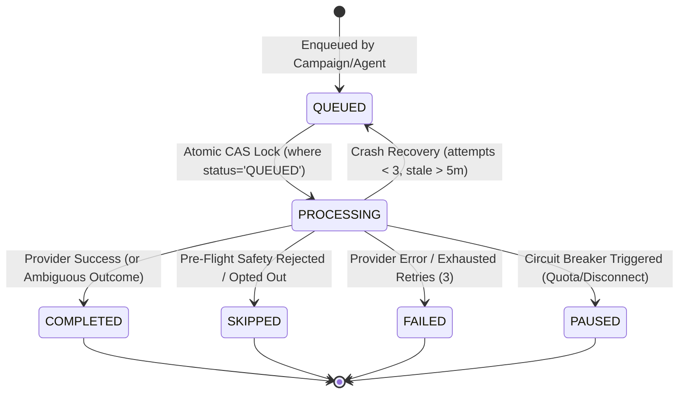

# WP-06: Action Queue State Machine, Concurrency & Ambiguous Outcome Handling

## 1. Executive Summary
This document provides audit evidence for the state machine transitions, concurrent lock mechanics, and duplicate dispatch prevention implemented for Work Package WP-06 ("Make Jobs and Schedules Reliable").

---

## 2. Action Queue State Machine

The queue worker manages asynchronous outbound LinkedIn actions (`CONNECT`, `MESSAGE`, `VIEW`, `REACT`, `COMMENT`) across 6 discrete states:



### 2.1 State Definitions
- **`QUEUED`:** Scheduled action waiting for execution (`scheduledFor <= now()`).
- **`PROCESSING`:** Action atomically claimed by an active worker thread (`lockedAt` populated, `attempts` incremented).
- **`COMPLETED`:** Outbound action successfully executed by provider and recorded in local CRM. Also used for **ambiguous provider outcomes** to strictly prevent duplicate sends.
- **`SKIPPED`:** Pre-flight checks determined action must not be executed (e.g. contact opted out, already connected, duplicate message copy). Non-retryable.
- **`PAUSED`:** Account circuit breaker tripped (e.g. daily quota reached, account disconnected, degraded health). Worker pauses processing for account safety.
- **`FAILED`:** Fatal error during provider dispatch or retry limit exceeded (`attempts >= 3`).

---

## 3. Atomic CAS Concurrency & Lock Acquisition

### 3.1 Lock Claim Implementation
- **Location:** `server/src/services/queue/queue.service.ts`
- **CAS Query:**
```typescript
const [claimed] = await db
  .update(actionQueue)
  .set({
    status: "PROCESSING",
    lockedAt: new Date(),
    attempts: job.attempts + 1,
  })
  .where(
    and(
      eq(actionQueue.id, job.id),
      eq(actionQueue.status, "QUEUED"),
    ),
  )
  .returning({ id: actionQueue.id });

if (!claimed) continue; // Lost race to another concurrent worker thread
```
- **Proof:** If multiple worker instances query due jobs simultaneously, only the single thread executing the atomic CAS update transitions the status to `PROCESSING` and receives the returned row ID. All other threads receive an empty array and skip the job without executing duplicate actions.

### 3.2 Two-Tier Crash & Stale Lock Recovery
- **Transient Failures (`attempts < 3`):** Stale locks (`lockedAt < now - 5m`) are reset to `QUEUED` with `lockedAt: null`, allowing another worker to resume execution.
- **Exhausted Failures (`attempts >= 3`):** Stale locks with 3 or more attempts are permanently transitioned to `FAILED` with `errorMessage = "Job execution timed out after maximum retry attempts."`, eliminating permanently orphaned `PROCESSING` records.

---

## 4. Ambiguous Provider Outcome Idempotency

### 4.1 The Duplicate Send Hazard
In outbound messaging systems, if a call to the external provider API succeeds, but the subsequent database update fails (e.g. transient DB connection drop, constraint violation), resetting or failing the job can cause a subsequent retry to re-send the exact same message to the LinkedIn user.

### 4.2 Guard Implementation
```typescript
let providerSuccess = false;
try {
  // Provider API dispatch
  const result = await linkedInMessageService.sendMessage(...);
  if (!result.success) throw new Error(...);
  providerSuccess = true;

  // Secondary CRM update
  await db.update(contacts)...;

  // Final queue state
  await db.update(actionQueue).set({ status: "COMPLETED", ... });
} catch (err: any) {
  const isAmbiguousProviderOutcome = providerSuccess;
  await db.update(actionQueue).set({
    status: isAmbiguousProviderOutcome ? "COMPLETED" : "FAILED",
    errorMessage: isAmbiguousProviderOutcome
      ? `Provider action succeeded, but secondary record update failed: ${err.message}`
      : err.message,
    lockedAt: null,
    executedAt: isAmbiguousProviderOutcome ? new Date() : null,
  });
}
```
- **Result:** If `providerSuccess === true`, the action is recorded as `COMPLETED` with a diagnostic note. It is NEVER reset to `QUEUED`, guaranteeing zero duplicate outreach messages.
