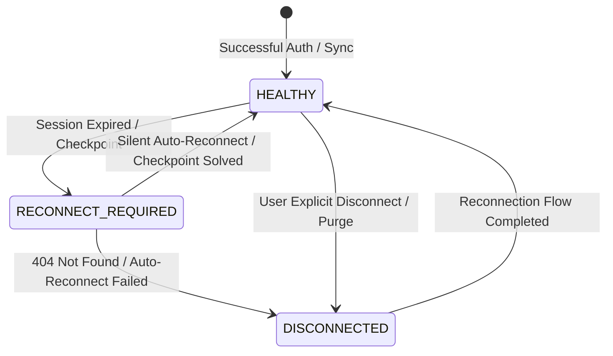

# WP-07: Account Health States & Silent Auto-Reconnect

## 1. Overview
WorkPilot tracks LinkedIn account connectivity using three health states and provides automatic recovery when remote session cookies expire.

---

## 2. Health State Machine

### 2.1 State Definitions
- **`HEALTHY`:** `isConnected = true`, `automationStatus = "RUNNING"`. Outbound queue actions and automated replies proceed normally.
- **`RECONNECT_REQUIRED`:** `isConnected = false`, `automationStatus = "PAUSED"`. Session cookies expired or Unipile flagged account for re-authentication. Pre-flight checks prevent action dispatch.
- **`DISCONNECTED`:** `isConnected = false`, `automationStatus = "PAUSED"`, `unipileAccountId = null`. User explicitly severed connection or account was purged.

---

## 3. Silent Auto-Reconnect Engine

### 3.1 Mechanics
- **Location:** `server/src/services/linkedin/account.service.ts` (`getAccountStatus`)
- When `getAccountStatus` queries live Unipile status and detects that the account is degraded (`!isHealthy`):
  1. It inspects `linkedinAccounts.encryptedCredentials` and `authMethod`.
  2. If present, it decrypts the credentials in memory.
  3. If `authMethod === "CREDENTIALS"`, it attempts silent re-authentication via `connectWithCredentials(userId, creds.username, creds.password)`.
  4. If `authMethod === "COOKIE"`, it attempts silent re-authentication via `connectWithCookie(userId, creds.li_at, { premiumToken: creds.li_a })`.
  5. If re-connection succeeds without a checkpoint challenge, the account is transparently restored to `HEALTHY` and `RUNNING` status without requiring manual user intervention.

### 3.2 Database State Auto-Healing
- If the live status from Unipile differs from the database record (e.g., account went disconnected remotely), `getAccountStatus` automatically updates `linkedinAccounts` to align `isConnected`, `healthStatus`, and `automationStatus`.

---

## 4. Test Evidence

Validated in `server/src/__tests__/unit/linkedin-account-lifecycle.test.ts`:
- `getAccountStatus auto-recovers healthy status via stored credentials when live status degraded` (PASS)
- `getAccountStatus auto-heals DB state when remote status transitions to disconnected` (PASS)
