# WP-09: End-to-End User Journey Map & Scenario Specifications

**Work Package:** WP-09 ("Verify Complete User Journeys", Handover Pages 22–23)  
**Baseline Commit:** `d4605327b523a11d362afc45620dd759c601a5bf`  
**Execution Date:** 2026-10-25  
**Verification Harness:** `server/src/__tests__/integration/user-journeys.test.ts`

---

## 1. Journey Landscape & Architecture Flow

The WorkPilot platform coordinates distributed user actions across authentication, LinkedIn sync, AI autonomous campaigns, outbound queue scheduling, real-time webhook ingest, and emergency account killswitches.

```mermaid
flowchart TD
    subgraph J1["Journey 1: Onboarding & Auth"]
        A1[User Signs Up / Logs In] --> A2[Request Connect URL: /api/linkedin/connect]
        A2 --> A3[Connect via Cookie / OAuth: /api/linkedin/connect/cookie]
        A3 --> A4[Health Status Verified: HEALTHY]
    end

    subgraph J2["Journey 2: Lead Discovery & CRM"]
        B1[Lead Discovered / Sourced] --> B2[Persisted into Contacts: status=NEW]
        B2 --> B3[Pipeline Progression: status=CONTACTED]
    end

    subgraph J3["Journey 3: Outbound Execution Loop"]
        C1[Campaign AI Enqueues Job: actionQueue] --> C2[CAS Worker Claims Lock]
        C2 --> C3[Pre-flight Safety Check]
        C3 --> C4[Provider Delivery: sendMessage]
        C4 --> C5[Job Status: COMPLETED]
    end

    subgraph J4["Journey 4: Inbound & Conversational Ingress"]
        D1[Unipile Inbound Webhook] --> D2[HMAC/Secret Auth Check]
        D2 --> D3[Deduplication / Idempotency]
        D3 --> D4[Immediate HTTP 200 Ack]
        D4 --> D5[Async Subagent Worker Dispatch]
    end

    subgraph J5["Journey 5: Opt-Out & Safety Halt"]
        E1[Prospect Requests Stop / Opt-Out] --> E2[Pre-flight Safety Interception]
        E2 --> E3[Queue Job Marked SKIPPED]
        E3 --> E4[All Outbound Communication Suppressed]
    end

    subgraph J6["Journey 6: Disconnect & Cookie Purge"]
        F1[User Triggers Disconnect: /api/linkedin/disconnect] --> F2[Queue Paused & Session Cleared]
        F2 --> F3[Permanent Cookie Purge: /api/linkedin/purge-cookies]
        F3 --> F4[Zero Credentials at Rest]
    end
```

---

## 2. Test Scenario Inventory

| Journey ID | Scenario Name | API Endpoints / Service Methods | Expected Result | Verified In Harness |
| :--- | :--- | :--- | :--- | :--- |
| **J1-01** | Connect URL Generation | `GET /api/linkedin/connect` | HTTP 200, hosted Unipile OAuth URL returned | Yes |
| **J1-02** | Session Cookie Auth & Status | `POST /api/linkedin/connect/cookie`, `GET /api/linkedin/status` | HTTP 200, state `HEALTHY`, credentials encrypted | Yes |
| **J2-01** | Lead Discovery & Fetching | `GET /api/dashboard/contacts` | HTTP 200, contacts scoped to user, stage=NEW | Yes |
| **J2-02** | Contact Stage Progression | `PATCH /api/dashboard/contacts/:id/stage` | HTTP 200, stage updated to CONTACTED | Yes |
| **J3-01** | Outbound Action Queue Cycle | `ActionQueueService.processDueActions` | Atomic CAS claim, safety verified, message sent, status=COMPLETED | Yes |
| **J4-01** | Inbound Webhook Processing | `POST /api/webhooks/unipile` | HTTP 200 within SLA, deduped, async worker dispatched | Yes |
| **J5-01** | Opt-Out Safety Negative Test | `ActionQueueService.processDueActions` | Pre-flight safety rejects, job marked SKIPPED, zero provider calls | Yes |
| **J6-01** | Account Disconnection | `POST /api/linkedin/disconnect` | HTTP 200, active sessions disconnected, queue paused | Yes |
| **J6-02** | Permanent Cookie Purge | `POST /api/linkedin/purge-cookies` | HTTP 200, credentials scrubbed, zero tokens in DB | Yes |

---

## 3. Invariant Checks

1. **Multi-Tenant Scoping:** All operations require strict user ID verification. No user can access or mutate another tenant's contacts, queue jobs, or LinkedIn accounts.
2. **Fail-Closed Safety:** If safety check fails or account is disconnected, worker halts immediately with status `SKIPPED` or `PAUSED`.
3. **Zero Data Leaks:** Cookies and tokens are encrypted with AES-256-GCM and completely erased upon purge.
