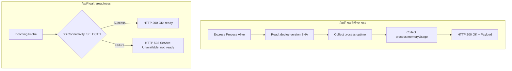

# WP-11: Health Probes & Telemetry Visibility Audit

**Work Package:** WP-11 ("Add Visibility and Recovery", Handover Pages 26–27)  
**Baseline Commit:** `d4605327b523a11d362afc45620dd759c601a5bf`  
**Execution Date:** 2026-10-25  
**Harness Tests:** `server/src/__tests__/unit/visibility-and-recovery.test.ts`

---

## 1. Health Probe Specifications

WorkPilot exposes high-visibility health endpoints for container schedulers (Kubernetes, AWS ECS, Docker Compose) and reverse proxies (AWS ALB, Nginx):



### Liveness Probe (`GET /api/health/liveness`)
- **Purpose:** Fast, non-blocking check to determine if the Node.js process is active and responsive.
- **Payload Schema:**
  ```json
  {
    "status": "ok",
    "version": "d4605327b523a11d362afc45620dd759c601a5bf",
    "commit": "d4605327b523a11d362afc45620dd759c601a5bf",
    "uptimeSeconds": 1420,
    "memory": {
      "rssBytes": 104857600,
      "heapUsedBytes": 52428800,
      "heapTotalBytes": 78643200
    },
    "timestamp": "2026-10-25T14:50:00.000Z"
  }
  ```

### Readiness Probe (`GET /api/health/readiness`)
- **Purpose:** Validates that database sockets are open and queries can execute before traffic is routed to the container.
- **Fail-Closed Behavior:**
  - Database reachable: `HTTP 200 { "status": "ready", "database": "connected" }`.
  - Database unreachable: `HTTP 503 { "status": "not_ready", "database": "disconnected", "error": "..." }`.

---

## 2. Ingress & Reverse Proxy Integration

Nginx and Docker Compose healthchecks are configured to use these probes directly:
- `docker-compose.yml`:
  ```yaml
  healthcheck:
    test: ["CMD", "wget", "--quiet", "--tries=1", "--spider", "http://127.0.0.1:4000/api/health/liveness"]
    interval: 15s
    timeout: 5s
    retries: 3
  ```
- `scripts/deploy-production.sh`:
  ```bash
  curl --fail --retry 10 --retry-delay 3 --max-time 10 "http://127.0.0.1:4000/api/health/liveness"
  ```
